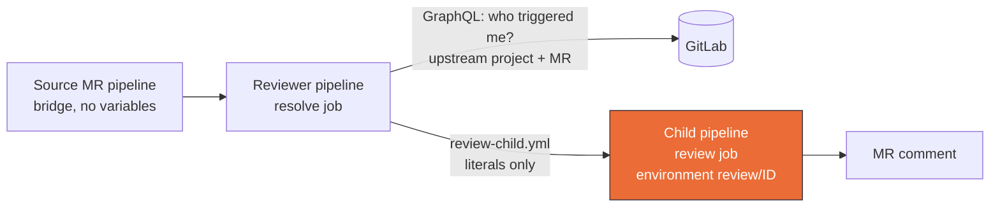

# CI Reviewer: Setup and Per-Case Guide

Run Maestro MR reviews from GitLab CI with zero project-local setup: one
**shared reviewer project** holds all secrets and the reviewer image, while
each source project only adds a small bridge job. Each source project can
bring its own AI provider and key, configured on the reviewer project. The
same review engine (`reviewEngine`) serves both the CI flow and the webhook
flow of a live DSH host running the `@ddtcorex/dsh-maestro-review` plugin, see
[Coexistence](#7-coexistence-ci-yields-to-webhook).

Templates: `templates/reviewer-project.gitlab-ci.yml` (copy into the reviewer
project), `templates/source-project.gitlab-ci.yml` (copy into each source
project). Image: `docker/Dockerfile`, published to Docker Hub as
`ddtcorex/maestro-reviewer:<version>` (the template pins an exact version,
see [troubleshooting](#9-troubleshooting) for why `:latest` is deliberately
not used).

---

## 0. Trust model

A trigger can override **every** variable of the downstream pipeline:
project CI variables, predefined ones such as `CI_JOB_TOKEN` and
`CI_SERVER_HOST`, and the job image when it is declared through a variable.
If source bridges could pass variables, anyone able to start a reviewer
pipeline could run their own image with the reviewer's secrets, or send the
token or an LLM key to a server of their choice. No check inside the job can
detect this, because the attacker controls the whole environment.

So the reviewer project **forbids pipeline variables**, and the reviewer
learns everything it needs from GitLab itself:



- `resolve` refuses to run unless the setting is `no_one_allowed`.
- It reads the upstream pipeline through GraphQL (`pipeline.upstream`), the
  MR from the upstream ref (`refs/merge-requests/<iid>/head`), the MR labels,
  and the source project's scoped provider settings.
- It writes `review-child.yml`, where the source project id, MR iid, GitLab
  host and provider route are **literal values**, and the review job carries
  `environment: review/<source project id>`, which is what makes per-project
  variables reach it.
- The review job runs `/entrypoint.sh` as before.

All of this was proven on GitLab CE 18.11.12 with eight probes; the
maintainers' local rig reruns them after every GitLab version change.

## 1. One-time setup: the reviewer project

1. Create a **private** GitLab project (for example `my-group/ci/reviewer`).
   Optionally set **Settings > CI/CD > General pipelines > Custom CI config
   path** to the file holding the reviewer template.
2. **Forbid pipeline variables:** **Settings > CI/CD > Variables > Minimum
   role to use pipeline variables = No one allowed** (API field
   `ci_pipeline_variables_minimum_override_role: no_one_allowed`).
3. **Protect the pipeline branch** (`main`, or whatever the bridges'
   `branch:` names): push and merge for **Maintainers** only, force push off,
   no per-user or per-group grants. Source developers are Developers here; if
   they could change the pipeline file they could read every protected key.
   `resolve` checks this on every run.
4. Copy `templates/reviewer-project.gitlab-ci.yml` and pin `REVIEWER_IMAGE`.
5. Set the CI/CD variables (all **Protected + Masked** where GitLab allows).
   Never define a variable named after a value the child pipeline pins
   (`SOURCE_PROJECT_ID`, `MR_IID`, `GITLAB_HOST`, `REVIEW_ROUTE*`,
   `REVIEW_DEEP_REQUESTED`): project variables outrank pipeline-file ones, so
   `resolve` refuses to run while one exists.

| Variable | Environment scope | What |
|---|---|---|
| `MAESTRO_GITLAB_TOKEN` | `*` | bot token, `api` scope: Developer on every source project, at least Reporter on this project (see [Bot identity](#bot-identity)) |
| `REVIEW_RESOLVE_TOKEN` | `resolve` | project access token **of this project**, Maintainer, `read_api` |
| `REVIEW_BOT_USERNAME` | `*` | the bot's username (recognition label for its own markers) |
| `REVIEW_ALLOWED_NAMESPACES` | `*` | **required**: comma-separated groups or projects allowed to use this reviewer (for example `my-group/, other-group/app`); an entry matches itself and everything below it |
| `DEEPSEEK_API_KEY`, or the `REVIEW_LLM_*` triple | `*` | the default provider, see [section 6](#6-model-selection) |
| `TELEGRAM_BOT_TOKEN` / `TELEGRAM_CHAT_ID` | `*` | optional review digest |

The allowlist matters because every source developer is a Developer here: without
it, anyone could point a personal project's bridge at this reviewer, spend the
default key, and feed content to an agent holding `MAESTRO_GITLAB_TOKEN`. A
project outside the list gets a no-op child pipeline and no note.

`REVIEW_RESOLVE_TOKEN` can read the setting and every project's scoped
variables, including other clients' keys. Its `resolve` scope is what keeps it
out of the review job, where an LLM agent reads untrusted MR content: GitLab
only injects a variable into jobs whose environment matches its scope.
**Confidentiality.** Every member who can trigger this project (Developer
and above) can also read every review job log and every review artifact
(`review-report.json`, `review-report.md`, kept one week) of every source
project, other clients included. Keep its membership to people trusted with
the code of every reviewed project; source projects with outside
contributors get a reviewer project of their own.

`CI_JOB_TOKEN` cannot replace `MAESTRO_GITLAB_TOKEN`: proven on GitLab 18.11,
reads work (`GET` = 200) but posting the review comment fails
(`POST /notes` = 401) even when the source project allowlists the reviewer.

### Bot identity

Comment authorship follows the token owner: every note the reviewer posts is
attributed to whoever owns `MAESTRO_GITLAB_TOKEN`, while
`REVIEW_BOT_USERNAME` is only the label the reviewer uses to clear its own
award markers and dedupe its own threads; it grants no permission.

1. Create a **Project Access Token** on the reviewer project (`api` scope,
   Developer role, a name such as `maestro-reviewer`). GitLab creates a bot
   user for it (`project_<id>_bot_<random>`). A project token lives at most 1
   year: record the expiry and rotate before it lapses, otherwise jobs
   "complete" without ever posting (`POST /notes` = 401).
2. Set `MAESTRO_GITLAB_TOKEN` to its secret and `REVIEW_BOT_USERNAME` to the
   bot username, as a pair.
3. Invite the bot user into **each source project** (Developer), or once at
   the shared group level.

The bridge runs as the user who fired the source pipeline, so every developer
opening MRs also needs Developer access on the reviewer project, otherwise
the bridge fails with `downstream_bridge_project_not_found`. With pipeline
variables forbidden that access only lets them start a reviewer pipeline; it
no longer lets them change what it runs.

## 2. Per-source setup: the bridge job

1. Copy the `maestro:trigger-review` job of
   `templates/source-project.gitlab-ci.yml` into the source project and set
   `trigger.project` to the reviewer project path (and `branch` to its
   default branch if that is not `main`).
2. The bridge holds **no secrets, passes no variables and forwards none**
   (`inherit: variables: false`, `forward: yaml_variables: false`). A bridge
   that passes any variable is rejected by GitLab
   (`downstream_pipeline_creation_failed`).
3. Everything that used to be a bridge variable (mode, profile, re-review on
   push) is now a reviewer-project variable scoped to this project, see the
   next section.

## 3. Per-project settings

Variables on the **reviewer project** with environment scope
`review/<source project id>` (for example `review/123`) apply to that source
project only; scope `*` holds the defaults. A scoped value wins over `*`.

| Variable | Meaning |
|---|---|
| `REVIEW_LLM_PROVIDER` | `openai`, `anthropic`, `gemini`, `openrouter`, `deepseek` or `custom` |
| `REVIEW_LLM_API_KEY` | the project's own provider key (masked) |
| `REVIEW_LLM_MODEL` | model id, required with a key |
| `REVIEW_LLM_BASE_URL` | required for `custom`, an override of the preset otherwise |
| `REVIEW_LLM_API` | `openai-completions` (default) or `openai-responses` |
| `REVIEW_REQUIRE_PROJECT_KEY` | `1`: never fall back to the default key; set at `*` it applies to every project, and a project's scoped `0` opts that project out |
| `REVIEW_MODE` | `quick` (default) or `deep` |
| `REVIEW_PROFILE` | `magento2`, `laravel`, `symfony`, `wordpress`, `generic` |
| `REVIEW_ON_PUSH` | `1`: re-review new pushes (default: first review only) |

Presets, all OpenAI-compatible endpoints:

| `REVIEW_LLM_PROVIDER` | Base URL |
|---|---|
| `openai` | `https://api.openai.com/v1` |
| `anthropic` | `https://api.anthropic.com/v1` |
| `gemini` | `https://generativelanguage.googleapis.com/v1beta/openai` |
| `openrouter` | `https://openrouter.ai/api/v1` |
| `deepseek` | `https://api.deepseek.com` |
| `custom` | none, set `REVIEW_LLM_BASE_URL` |

There is no default model per preset: model names change too often.

**A project route is all or nothing.** GitLab merges variables one by one,
so a project that scoped only a key and a model would inherit the default
base URL and send its key to the default provider. `resolve` therefore
requires, at the project's own scope, `REVIEW_LLM_MODEL` and either
`REVIEW_LLM_PROVIDER` or `REVIEW_LLM_BASE_URL` whenever `REVIEW_LLM_API_KEY`
is scoped, and rejects LLM settings scoped without a key, or a base URL or
model with characters GitLab would expand (only `http(s)://` plus
`A-Za-z0-9.:/_+-`). It fails the reviewer pipeline naming what is missing.
`resolve` pins the model and a hash of the key it saw into the child; the
review job refuses any other key, so a key deleted or changed in between can
never let the default key reach the project's endpoint. On a project route
the default-scope `REVIEW_MODEL_PROVIDER`/`REVIEW_MODEL` pin is ignored.
Wildcard scopes such as `review/*` are not supported: one would hand a
project's key or mode to every matching project, so `resolve` refuses to run
while any variable of the table above has a scope containing `*` other than
exactly `*`. Use exact `review/<id>` scopes.

**Require switch.** With `REVIEW_REQUIRE_PROJECT_KEY=1` (at the project's
scope, or at `*` for every project) and no scoped key, the MR gets one note ("AI review is not configured
for this project", marked `<!-- maestro-review-unconfigured -->`, posted once)
and no model is called. Use it for a client who pays for their own reviews,
so a missing key never silently bills the default key.

## 4. Trigger cases

### Case A: quick review, automatic (default)

The bridge fires on every MR pipeline (`merge_request_event`). The reviewer
runs `quick`: diff-only for the `generic` profile; with a framework profile
(for example `magento2`) it clones the source at the head SHA and runs the
profile's reviewer on the checkout, reviewer-only. The comment header carries
the profile. Artifacts `review-report.json` and `review-report.md` are always
uploaded by the review job (even on skip or failure).

### Case B: deep review, on demand

Add the MR label **`maestro-review::deep`**, then retry the bridge job or
push. `resolve` turns the label into a deep request:

- A deep request always runs deep, whatever `REVIEW_MODE` says.
- Deep runs **once per head SHA**: it runs even when that SHA already has a
  quick review, and skips only when the bot already posted a deep review for
  it.
- After the deep review is posted the bot removes the label, so every deep
  run (the costly one) is an explicit request. A failed run keeps the label,
  so a retry works.

Deep clones the source at the MR head SHA with `MAESTRO_GITLAB_TOKEN`
(oauth2) and runs reviewer plus a **static-only** auditor (no runtime
environment exists in the container). A project can default to deep with
`REVIEW_MODE=deep` at its scope.

### Case C: quick review via webhook mention (mapped projects)

On a live DSH host with the `@ddtcorex/dsh-maestro-review` plugin and the
project mapped (Settings > Maestro Review): comment
`@<bot-username>` on the MR. Routes `trigger=mention, mode=quick`. Unmapped
projects get the diff-only fallback comment instead.

### Case D: deep review via webhook (mapped projects only)

Comment `@<bot-username>` plus the `/maestro deep` slash command or the
phrase "deep review" (a bare "deep" never triggers). Runs reviewer plus
auditor with the full environment and test-suite workflow. Unmapped projects
get the **Not started** decline comment via webhook (deep needs a local
checkout; Case B is the CI alternative). The decline is recorded as
`completed` in history.

### Case E: re-reviewing pushes

- **CI**: `REVIEW_ON_PUSH=1` at the project's scope (or `*`). Unset means
  only the first review runs and new pushes are skipped; the same head SHA
  always skips.
- **Webhook**: Settings > Maestro Review > `autoRereviewOnPush` (same
  semantics), plus the webhook push-gate: a push only re-reviews an MR that
  already has a completed review in host history. Review-on-assign defaults
  **on**; re-review-on-push defaults **off**; both support per-project
  override of the global value.

## 5. Push-gate and re-review

The bridge fires on **every** MR pipeline, so the review job gates on the
head SHA before booting any agent:

| Situation | Result |
|---|---|
| Same head SHA already reviewed | `already reviewed at <sha>, skipping` |
| New commits, `REVIEW_ON_PUSH` unset | `new commits since <sha> but REVIEW_ON_PUSH is not set, skipping` |
| New commits, `REVIEW_ON_PUSH=1` | runs (quick gets the incremental-changes block) |
| Head SHA has a completed bot review marker | `webhook already reviewed <sha>, skipping` |
| The bot's eyes award is on the MR | `another review is running, skipping` |
| Deep requested, bot deep review exists for the SHA | `deep review already completed at <sha>, skipping` (label removed) |

The gate reads its state from GitLab: the newest review comment **posted by
the token's own user**, through the hidden metadata block next to the review
marker. Comments without that block (posted before 0.14) do not count, so
each MR open during the upgrade is reviewed once more. Notes and awards by
anyone else are ignored, so a pasted marker or a human's eyes reaction cannot
suppress a review. The runner cache (`.maestro-history/`, keyed per MR) is
only a fallback for when GitLab cannot be read, and a per-MR `resource_group`
runs one review per MR at a time.

## 6. Model selection

No settings mount required; everything is variable driven.

| Route | When | Uses |
|---|---|---|
| project | the project has a scoped `REVIEW_LLM_API_KEY` | its key and model, the preset or scoped base URL ([section 3](#3-per-project-settings)) |
| default, bring your own | `REVIEW_LLM_API_KEY` at `*` | `REVIEW_LLM_BASE_URL`, `REVIEW_LLM_MODEL` (both required), optional `REVIEW_LLM_API` |
| default, baked | nothing above | deepseek-official from `api.deepseek.com`, `DEEPSEEK_API_KEY` |

- `REVIEW_MODEL_PROVIDER` + `REVIEW_MODEL` (set both or neither) pin a model
  on the default route; a project route ignores them.
- Base URLs and model ids are charset-checked before they reach the settings
  file; anything else fails closed.

## 7. Coexistence: CI yields to webhook

CI-posted comments end with an invisible marker and the metadata block:

```html
<!-- maestro-review sha=<headSHA> flow=<ci-quick|ci-deep> status=completed -->
<!-- maestro-review-meta:v1 <base64url> -->
```

Before booting, every CI review skips when a completed bot marker for the
same head SHA exists, or when the bot's eyes award shows a review in flight.
The webhook path posts **marker-free** comments, so this check only sees
CI-posted reviews: webhook and CI on the same head SHA both post. Pick one
flow per MR: mapped projects normally use the webhook, CI deep on demand.
The CI flow only sees a webhook review in flight when both flows use the same
GitLab user.

## 8. Upgrading from 0.13

0.14 has no compatibility path. In one maintenance window:

1. Move each source project's bridge variables (`REVIEW_MODE`,
   `REVIEW_PROFILE`, `REVIEW_ON_PUSH`) to reviewer variables scoped
   `review/<id>`.
2. Set the reviewer project's pipeline variables to **No one allowed**, protect
   its pipeline branch for Maintainers only, and set
   `REVIEW_ALLOWED_NAMESPACES`.
3. Create `REVIEW_RESOLVE_TOKEN` (scope `resolve`), and give the bot user at
   least Reporter on the reviewer project.
4. Replace the reviewer project's pipeline file and every source bridge with
   the new templates. Until a bridge is replaced, GitLab rejects it.
5. Add client keys at their scopes, verify one real MR, and verify that a
   bridge passing a variable is rejected.
6. Rotate `MAESTRO_GITLAB_TOKEN` and the default LLM key: before step 2 any
   member able to trigger the reviewer project could read them.

Testing a new image by passing `REVIEWER_IMAGE` through a trigger no longer
works by design; build and test it on a separate reviewer project.

## 9. Troubleshooting

- **`resolve failed: pipeline variables are not restricted`**: set **Minimum
  role to use pipeline variables** to **No one allowed** on the reviewer
  project.
- **`missing REVIEW_RESOLVE_TOKEN` / `cannot read the reviewer project's
  pipeline-variables setting`**: the token is missing, not Maintainer, lacks
  `read_api`, or is not scoped to `resolve`.
- **`its upstream is not visible`**: `MAESTRO_GITLAB_TOKEN`'s user needs at
  least Reporter on the reviewer project and on the source project.
- **`branch main of the reviewer project is not protected` / `must be
  protected for Maintainers only`**: see [section 1](#1-one-time-setup-the-reviewer-project), step 3.
- **`project variable(s) ... would override what the child pipeline pins`**:
  delete those variables from the reviewer project.
- **`the project key changed since resolve`**: the project's scoped key was
  changed or deleted after `resolve` ran (or an old child job was retried);
  rerun the whole reviewer pipeline, never only the child job.
- **`REVIEW_ALLOWED_NAMESPACES is not set`** or **`project ... is not in
  REVIEW_ALLOWED_NAMESPACES`**: add the project's group (or the project) to the
  allowlist.
- **`incomplete provider settings for project <id>`**: the project's scope is
  partial; the message names the missing variables
  ([section 3](#3-per-project-settings)).
- **Bridge fails with `downstream_pipeline_creation_failed`**: the bridge
  passes or forwards variables; replace it with the current source template.
- **Bridge fails instantly otherwise**: `branch:` does not match the reviewer
  project's default branch, or the pipeline user lacks access.
- **Run "completes" but no comment appears**: `MAESTRO_GITLAB_TOKEN` lacks
  `api` scope or Developer on the source project; the orchestrator logs
  `posting review comment failed` with the status.
- **`another review is running, skipping` with no active review**: a stale
  bot eyes award (a cancelled pipeline never ran its cleanup). Delete it from
  the MR's `award_emoji` and retry.
- **Job uses an old image**: the template pins an exact version tag on
  purpose; a moving tag would change every deployment with no changelog to
  trace. Bump `REVIEWER_IMAGE` in the reviewer project's copy.
- **Reports or artifacts missing**: the entrypoint must `cd $CI_PROJECT_DIR`
  before capturing the report dir; keep that line if you fork `entrypoint.sh`.

## 10. Host observability (webhook flow)

The webhook flow runs in `@ddtcorex/dsh-maestro-review`; its host log lines
keep the `maestro-orchestrator:` prefix.

- **Dry-run the CI contract** without model calls: `REVIEW_DRY_RUN=1`
  validates the review job's variables and exits before booting agents.
- **Tailing the host log**: every drop or dedup leaves one structured line:
  `drop unmapped|assign-gate-off|push-gate-off|push-no-completed-history|missing-token`,
  `deduped duplicate in-flight review key=… trigger=…`, intake
  `drop invalid-identity`. Generic GitLab noise (closes, label edits) stays
  silent.
- **In-flight key**: `projectId:mrIid:mode:scope:trigger[:pushSha8]`: quick
  and deep and distinct push SHAs never suppress each other.
- **History** (`~/.dsh/dsh-maestro-review/reviews.json`, cap 100): `running`
  entries older than 2h auto-fail; prune never drops `running`;
  `reviewSessionRetentionDays=0` disables prune.
