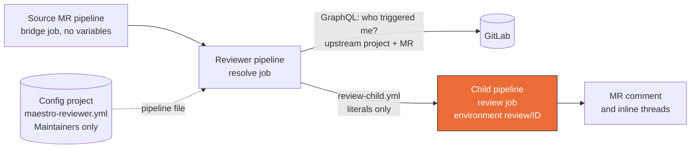

# CI Reviewer: Setup and Variable Reference

Run Maestro merge-request reviews from GitLab CI with no setup inside the
projects being reviewed. One **reviewer project** holds the secrets and runs
the reviewer image, one small **config project** holds the pipeline file, and
each **source project** adds a bridge job that carries no secrets. Each source
project can use its own AI provider and key, configured on the reviewer
project. The same review engine (`reviewEngine`) also serves the webhook flow
of a DSH host running the `@ddtcorex/dsh-maestro-review` plugin, see
[Coexistence](#9-coexistence-ci-yields-to-webhook).

Files in this package:

| File | Copy it to |
|---|---|
| `templates/reviewer-project.gitlab-ci.yml` | the config project, as `maestro-reviewer.yml` |
| `templates/source-project.gitlab-ci.yml` | each source project's `.gitlab-ci.yml` (the `maestro:trigger-review` job) |
| `docker/Dockerfile` | nothing: the image is published as `ddtcorex/maestro-reviewer:<version>` |

Contents:

1. [How it works](#1-how-it-works)
2. [Who needs which access](#2-who-needs-which-access)
3. [Setup, step by step](#3-setup-step-by-step)
4. [Variable reference](#4-variable-reference)
5. [Daily use](#5-daily-use)
6. [Onboarding another source project](#6-onboarding-another-source-project)
7. [Push-gate and re-review](#7-push-gate-and-re-review)
8. [Model selection](#8-model-selection)
9. [Coexistence: CI yields to webhook](#9-coexistence-ci-yields-to-webhook)
10. [Upgrading](#10-upgrading)
11. [Troubleshooting](#11-troubleshooting)
12. [Host observability (webhook flow)](#12-host-observability-webhook-flow)

---

## 1. How it works



1. A merge request pipeline in a source project runs the bridge job
   `maestro:trigger-review`. It starts a pipeline in the reviewer project and
   passes nothing to it.
2. GitLab builds that pipeline from the file in the config project (the
   reviewer project's **Custom CI config path** points there).
3. The `resolve` job checks the reviewer's own safety settings, then asks
   GitLab which pipeline triggered it, which project and MR that is, whether
   the project is allowed, and which provider settings apply to it.
4. `resolve` writes `review-child.yml` with those answers as literal values.
   The child pipeline's `review` job runs in the environment
   `review/<source project id>`, which is what lets that project's own
   variables reach it.
5. The review job reviews the MR and posts one summary comment plus inline
   threads, as the user who owns `REVIEW_GITLAB_TOKEN`.

### Trust model

A trigger can override **every** variable of the downstream pipeline:
project CI variables, predefined ones such as `CI_JOB_TOKEN` and
`CI_SERVER_HOST`, and the job image when it comes from a variable. If bridges
could pass variables, anyone able to start a reviewer pipeline could run their
own image with the reviewer's secrets, or send the token or an LLM key to a
server of their choice. No check inside the job can detect that, because the
attacker controls the whole environment. So:

- The reviewer project **forbids pipeline variables**, and the reviewer learns
  everything from GitLab itself (GraphQL `pipeline.upstream`, the upstream ref
  `refs/merge-requests/<iid>/head`, the MR labels, the scoped variables).
- The pipeline file receives every key, so only Maintainers may change it.
  It cannot live on the reviewer project's own branch: GitLab only lets a user
  trigger a protected downstream branch when they are allowed to push or merge
  it, so that branch must let every source developer merge. The file therefore
  lives in a separate config project, protected for Maintainers only.
- Only allowlisted namespaces may use the reviewer
  (`REVIEW_ALLOWED_NAMESPACES`), so a personal project can neither spend the
  default key nor feed content to an agent holding the bot token.

`resolve` checks all of this on every run and fails closed, naming the fix.
These mechanisms were proven on GitLab CE 18.11.12; the maintainers' local rig
reruns the probes after every GitLab version change.

## 2. Who needs which access

| Who | Project | Minimum role | Why |
|---|---|---|---|
| Every user whose MR should be reviewed (the bridge runs as the user who started the source pipeline) | reviewer project | Developer, and allowed to merge its pipeline branch | GitLab refuses to create the downstream pipeline otherwise (`insufficient_bridge_permissions`) |
| the same users | config project | Reporter | GitLab must read the pipeline file as them (the bridge fails otherwise) |
| the bot (owner of `REVIEW_GITLAB_TOKEN`) | every source project | Developer | posts the comment and threads, sets and clears award markers, removes the deep label, clones the source for profile and deep reviews |
| the bot | reviewer project | Reporter, **below Maintainer** | `resolve` reads its own upstream pipeline through GraphQL; a Maintainer could read every key through the API, so `resolve` refuses Maintainer or above |
| the bot | config project | exactly Reporter | `resolve` reads the config branch protection; the review job holds this token while an agent reads untrusted MR content, so the bot must not be able to change the pipeline file or create refs there (`resolve` refuses Developer or above, counting group memberships and shared groups) |
| `REVIEW_RESOLVE_TOKEN` (a project access token) | reviewer project | Maintainer, scope `read_api` | reads the pipeline-variables setting, the CI config path and the variable scopes |
| people who change the pipeline file or the reviewer's variables | config project and reviewer project | Maintainer | keep this list short: a reviewer Maintainer can read every key |

The bot must be a dedicated, non-admin account: `resolve` refuses a token
that belongs to a GitLab administrator, and a person's own token is usually
Maintainer on the reviewer project, which it refuses too.

**Confidentiality.** Every member of the reviewer project can read every
review job log and every review artifact (`review-report.json`,
`review-report.md`, kept one week) of every source project. Keep its
membership to people trusted with the code of all reviewed projects; projects
with outside contributors get a reviewer project of their own.

## 3. Setup, step by step

### 3.1 Config project

1. Create a **private** project next to the reviewer project, for example
   `my-group/ci/reviewer-config`.
2. Add `templates/reviewer-project.gitlab-ci.yml` to its default branch as
   `maestro-reviewer.yml`, and pin `REVIEWER_IMAGE` to an exact version
   (for example `ddtcorex/maestro-reviewer:0.16.0`).
3. **Settings > Repository > Protected branches**: protect the default branch
   with **Allowed to merge = Maintainers**, **Allowed to push and merge =
   Maintainers**, force push off, and no per-user or per-group entries.
   GitLab applies the most permissive of all rules matching a branch, so
   every rule that matches it, wildcards such as `*` included, must be the
   same; `resolve` checks them all.
4. **Manage > Members**: add the bot as **Reporter**, and give **Reporter** to
   everyone who opens MRs in the source projects. Inviting groups is fine at
   Reporter, but the bot's role here must stay Reporter through every path:
   direct, inherited from a parent group, or through a shared group.

### 3.2 Reviewer project

1. Create a **private** project, for example `my-group/ci/reviewer`. Its
   repository can stay empty apart from a README: GitLab does not read it.
   It must not contain a file at the literal config path from step 2
   (`resolve` refuses, because Developers can now merge into it).
2. **Settings > CI/CD > General pipelines > CI/CD configuration file**
   (Custom CI config path): `maestro-reviewer.yml@my-group/ci/reviewer-config`.
   An explicit branch is allowed (`...@my-group/ci/reviewer-config:stable`);
   it must then be the protected branch from 3.1, never a tag or a SHA. The
   file name must end in lowercase `.yml` or `.yaml` and the value must not
   contain `http:` or `https:`: GitLab reads anything else from the reviewer
   repository or a remote URL, and `resolve` refuses it. These rules follow
   GitLab 17.11 to 18.11; on older versions the literal-file check in step 1
   still applies.
3. **Settings > CI/CD > Variables > Minimum role to use pipeline variables:
   No one allowed** (API field
   `ci_pipeline_variables_minimum_override_role: no_one_allowed`).
4. **Settings > Repository > Protected branches**: protect the default branch
   (the bridges' `branch:`) with **Allowed to merge = Developers + Maintainers**
   and **Allowed to push and merge = Maintainers**. Protection is still needed:
   protected variables only reach pipelines on protected branches.
5. **Manage > Members**: add the bot as **Reporter** and everyone who opens
   MRs in the source projects as **Developer**.
6. Create the tokens (3.3) and the variables ([section 4](#4-variable-reference)).

### 3.3 Bot identity and tokens

Every note the reviewer posts is attributed to the owner of
`REVIEW_GITLAB_TOKEN`. Use a dedicated identity, never a person's own token:
a personal token posts as that person and grants the review job everything
that person can do.

- **Dedicated bot user** (recommended for many source projects): create a
  user such as `maestro-bot`, give it the roles from section 2, and create a
  personal access token with scope `api` as that user.
- **Group access token** (`api`, role Developer) on a group containing every
  source project: GitLab creates a bot user for it. Use it only when the
  reviewer and config projects sit **outside** that group: inside it, the bot
  would inherit Developer on the config project, which `resolve` refuses, and
  GitLab cannot lower an inherited role. Then give the bot Reporter on both.

Then:

1. Store the token as `REVIEW_GITLAB_TOKEN` and the bot's username as
   `REVIEW_BOT_USERNAME`, together.
2. On the reviewer project, **Settings > Access tokens**: create a project
   access token, role **Maintainer**, scope **`read_api`**, and store it as
   `REVIEW_RESOLVE_TOKEN` with environment scope `resolve`.
3. Record both expiry dates. An expired `REVIEW_GITLAB_TOKEN` makes reviews
   "complete" without posting (`POST /notes` answers 401); an expired
   `REVIEW_RESOLVE_TOKEN` fails `resolve` with a Maintainer hint.

`CI_JOB_TOKEN` cannot replace `REVIEW_GITLAB_TOKEN`: on GitLab 18.11 reads
work but posting the comment fails (`POST /notes` = 401), even when the source
project allowlists the reviewer.

### 3.4 Source project bridge

1. Copy the `maestro:trigger-review` job of
   `templates/source-project.gitlab-ci.yml` into the source project's
   `.gitlab-ci.yml`, add `review` to its `stages:`, and set `trigger.project`
   to the reviewer project path and `branch:` to its protected default branch.
2. The bridge holds **no secrets, passes no variables and forwards none**
   (`inherit: variables: false`, `forward: yaml_variables: false`,
   `pipeline_variables: false`). A bridge that passes any variable is
   rejected by GitLab (`downstream_pipeline_creation_failed`).
3. `allow_failure: true` keeps a reviewer outage from blocking merges and
   deploys; remove it only if a failed review must block the merge.
4. Add the project (or its group) to `REVIEW_ALLOWED_NAMESPACES`, and the bot
   as Developer on it.

Mode, profile and re-review on push are not bridge settings: they are
reviewer-project variables scoped to the project ([section 4.3](#43-per-source-project-settings-scope-reviewsource-project-id)).

### 3.5 Verify

Open a throwaway MR in a source project **as a user with Developer only**
(a Maintainer can trigger branches a Developer cannot, so a Maintainer's MR
proves less), then check:

| Where | Expected |
|---|---|
| source MR pipeline, job `maestro:trigger-review` | passed, links to a reviewer pipeline |
| reviewer pipeline, job `resolve` | passed; log shows the upstream project and MR, no `resolve failed` line |
| reviewer child pipeline, job `review` | passed; log ends with `ci-trigger finished: ok=true` |
| the MR | one `Maestro Review` comment by the bot, inline threads for findings |

Also prove the restriction holds: a bridge that passes a variable must be
rejected by GitLab.

## 4. Variable reference

All variables below are CI/CD variables of the **reviewer project**
(**Settings > CI/CD > Variables**), never of a source project, and never of
the config project.

### 4.1 GitLab flags, and how to set them

| Flag | Meaning | Set it |
|---|---|---|
| **Protected** | only reaches pipelines on protected branches or tags | on every variable here; the reviewer branch is protected (3.2 step 4) |
| **Masked** (or **Masked and hidden**) | replaced by `[MASKED]` in job logs; hidden also blocks reading it back in the UI | on secrets only (tokens and keys); a value must be one line, at least 8 characters, without spaces |
| **Expand variable reference** | GitLab replaces `$NAME` inside the value with another variable | **off** for every token and key (a key containing `$` would be silently changed) and for URLs; `resolve` also rejects a base URL or model containing `$` |
| **Environment scope** | which jobs receive it: `*` every job, `resolve` only the resolve job, `review/<id>` only the review job of source project `<id>` | as listed per variable |

A scoped value wins over the same name at `*` for that project. Wildcard
scopes such as `review/*` are refused for the per-project names in 4.3: one
would hand a project's key or mode to every matching project.

Variables inherited from parent groups or the instance also reach these jobs
and rank above the pipeline file. `resolve` sees only the reviewer project's
own variables, so check **Group variables (inherited)** on that page by hand
for any name from [4.5](#45-pinned-by-the-pipeline-never-define).

### 4.2 Reviewer project, scope `*`

| Variable | Required | Flags | Meaning |
|---|---|---|---|
| `REVIEW_GITLAB_TOKEN` | yes | protected, masked, expand off | The bot's token, scope `api` (3.3). Posts the review, reads the source MR and pipeline, clones for profile and deep reviews. Renamed from `MAESTRO_GITLAB_TOKEN` in 0.15. |
| `REVIEW_RESOLVE_TOKEN` | yes, **scope `resolve`** | protected, masked, expand off | Project access token of the reviewer project, Maintainer, `read_api` (3.3). It can read every project's scoped keys, which is why its scope keeps it out of the review job, where an agent reads untrusted MR content. |
| `REVIEW_ALLOWED_NAMESPACES` | yes | protected | Comma-separated groups or projects allowed to use the reviewer, for example `my-group/, other-group/app`. An entry matches itself and everything below it (`my-group` matches `my-group/app`, not `my-group-old/app`). A project outside it gets a no-op pipeline, no review and no note; an empty value fails `resolve`. |
| `REVIEW_BOT_USERNAME` | strongly recommended (default `maestro-bot`) | protected | Username of the token's owner. The reviewer clears its own award markers (eyes while running) by this name; if it is wrong a stale eyes marker stays and later runs skip with `another review is running`. It grants no permission. |
| `DEEPSEEK_API_KEY` | one default provider is required | protected, masked, expand off | Key for the baked default route (DeepSeek, `api.deepseek.com`, model `deepseek-v4-flash`). |
| `REVIEW_LLM_API_KEY` | instead of `DEEPSEEK_API_KEY` | protected, masked, expand off | Default bring-your-own key for any OpenAI-compatible endpoint. At `*` it needs `REVIEW_LLM_BASE_URL` and `REVIEW_LLM_MODEL` too (the job fails closed otherwise). |
| `REVIEW_LLM_BASE_URL` | with `REVIEW_LLM_API_KEY` | protected, expand off | Endpoint base URL, for example `https://llm.example.com/v1`. Allowed characters: `A-Za-z0-9:/_.+-`. At `*`, `REVIEW_LLM_PROVIDER` presets are not applied: give the URL. |
| `REVIEW_LLM_MODEL` | with `REVIEW_LLM_API_KEY` | protected | Model id at that endpoint. Allowed characters: `A-Za-z0-9/_+.-`. |
| `REVIEW_LLM_API` | no (default `openai-completions`) | protected | Wire protocol: `openai-completions` or `openai-responses`. |
| `REVIEW_MODEL_PROVIDER`, `REVIEW_MODEL` | no, set both or neither | protected | Pin a model on the default route: provider `deepseek-official` (baked route) or `custom-openai` (bring-your-own route) plus a model id, for example `deepseek-official` + `deepseek-v4-pro`. Ignored on a project route. |
| `REVIEW_REQUIRE_PROJECT_KEY` | no | protected | `1` at `*`: no project ever falls back to the default key; a project without its own key gets one "AI review is not configured" note and no model call. A project's scoped `0` opts it out. |
| `REVIEW_MODE`, `REVIEW_PROFILE`, `REVIEW_ON_PUSH`, `REVIEW_IGNORE_GLOBS` | no | protected | Defaults for every project, same meaning as in 4.3. |
| `REVIEW_ACCEPT_PRIVILEGED_BOT` | no, temporary only | protected | `1`: a bot that is Developer or above on the config project, or Maintainer or above on the reviewer project, only logs a warning instead of failing `resolve`. For the period before a dedicated bot user exists (for example a Maintainer's own token). It accepts the risk the check exists for: an agent reading untrusted MR content holds a token that can read every key and change the pipeline file. Administrators stay refused; every other check stays. Delete it as soon as a dedicated bot is in place. |

### 4.3 Per source project settings, scope `review/<source project id>`

Use the numeric project id (shown on the project's overview page), for example
`review/123`. These apply to that project only and win over `*`.

| Variable | Values | Meaning |
|---|---|---|
| `REVIEW_MODE` | `quick` (default), `deep` | `deep` makes every review of this project a deep one (costly); usually leave `quick` and request deep per MR with the label (5.2). |
| `REVIEW_PROFILE` | `magento2`, `laravel`, `symfony`, `wordpress`, `generic` | Framework checklist. Unset or `generic`: diff-only review. A framework profile clones the source at the head SHA and reviews the checkout. An unknown value fails the job. |
| `REVIEW_ON_PUSH` | `1` | Re-review new pushes with an incremental-changes block. Unset: only the first review of an MR runs. |
| `REVIEW_IGNORE_GLOBS` | comma-separated globs, for example `docs/**, **/*.svg` | Extra paths kept from the model, added to the defaults: `**/package-lock.json`, `**/pnpm-lock.yaml`, `**/yarn.lock`, `**/composer.lock`, `**/*.min.js`, `**/*.min.css`, `**/*.map`, `**/generated/**`, `pub/static/**`, `var/**`, `**/__snapshots__/**`, `**/i18n/*.csv`. A deleted file is matched on its old path. Skipped files are listed in the review comment; an MR whose every file matches gets one "Nothing reviewable" comment and no model call. A checkout review can still read a skipped file from the worktree. |
| `REVIEW_LLM_PROVIDER` | `openai`, `anthropic`, `gemini`, `openrouter`, `deepseek`, `custom` | The project's own provider; a preset fills the base URL ([table](#provider-presets)), `custom` needs `REVIEW_LLM_BASE_URL`. |
| `REVIEW_LLM_API_KEY` | the project's key (masked, expand off) | Bills this project's reviews to its own key. |
| `REVIEW_LLM_MODEL` | model id | Required with a project key; there is no default model per preset. |
| `REVIEW_LLM_BASE_URL` | URL | Required for `custom`, an override of the preset otherwise. |
| `REVIEW_LLM_API` | `openai-completions`, `openai-responses` | Wire protocol, default `openai-completions`. |
| `REVIEW_REQUIRE_PROJECT_KEY` | `1`, `0` | `1`: never use the default key for this project; `0`: opt out of a `1` set at `*`. |

**A project route is all or nothing.** GitLab merges variables one by one, so
a project that scoped only a key and a model would inherit the default base
URL and send its key to the default provider. With a scoped
`REVIEW_LLM_API_KEY`, `resolve` therefore requires, at the same scope,
`REVIEW_LLM_MODEL` and either `REVIEW_LLM_PROVIDER` or `REVIEW_LLM_BASE_URL`,
and it rejects LLM settings scoped without a key. It fails the reviewer
pipeline naming what is missing. `resolve` pins the model and a hash of the
key it saw into the child; the review job refuses any other key, so a key
deleted or changed in between can never let the default key reach the
project's endpoint.

#### Provider presets

| `REVIEW_LLM_PROVIDER` | Base URL |
|---|---|
| `openai` | `https://api.openai.com/v1` |
| `anthropic` | `https://api.anthropic.com/v1` |
| `gemini` | `https://generativelanguage.googleapis.com/v1beta/openai` |
| `openrouter` | `https://openrouter.ai/api/v1` |
| `deepseek` | `https://api.deepseek.com` |
| `custom` | none, set `REVIEW_LLM_BASE_URL` |

### 4.4 In the pipeline file

| Variable | Where | Meaning |
|---|---|---|
| `REVIEWER_IMAGE` | `variables:` of `maestro-reviewer.yml` in the config project | The reviewer image, pinned to an exact version. Bump it there for a new release. Do not also define it as a project variable: that would win over the file. |

### 4.5 Pinned by the pipeline, never define

`resolve` writes these into the child pipeline as literals. Project variables
outrank the pipeline file, so `resolve` refuses to run while the reviewer
project defines any of them, at any scope:

`SOURCE_PROJECT_ID`, `MR_IID`, `GITLAB_HOST`, `REVIEW_ROUTE`,
`REVIEW_ROUTE_BASE_URL`, `REVIEW_ROUTE_API`, `REVIEW_ROUTE_MODEL`,
`REVIEW_ROUTE_KEY_SHA`, `REVIEW_DEEP_REQUESTED`.

For a deep request the child also sets `REVIEW_MODE: deep`; a project's own
`REVIEW_MODE` cannot cancel it, because `REVIEW_DEEP_REQUESTED` wins.

### 4.6 Debugging only

| Variable | Meaning |
|---|---|
| `REVIEW_DRY_RUN` | `1`: validate the review job's variables and exit before booting any agent (no model call). Use it with a local `docker run` of the image, not as a reviewer project variable: at `*` it would silently turn every review into a dry run. |

## 5. Daily use

### 5.1 Quick review (automatic)

Every MR pipeline of an allowlisted project runs the bridge. The first
pipeline of an MR gets a quick review: diff-only for the `generic` profile,
or the profile's checklist on a checkout of the head SHA. The bot posts one
`Maestro Review` comment (verdict, summary, findings by severity) and an
inline thread per finding. The review job always uploads
`review-report.json` and `review-report.md` (kept one week), even on skip or
failure. When agents ran, `review-report.json` also carries `toolCalls`: how
many times the agents attempted each tool, the data used to decide which
review tools are worth keeping. A finding never fails the pipeline; only a reviewer-infra problem
does, and the bridge's `allow_failure` keeps that from blocking the merge.

### 5.2 Deep review (on demand)

Add the MR label **`maestro-review::deep`**, then retry the bridge job or
push. The reviewer runs the reviewer and a static-only auditor on a clone of
the head SHA (no runtime environment exists in the container).

- A deep request always runs deep, whatever `REVIEW_MODE` says.
- Deep runs **once per head SHA**: it runs even when that SHA already has a
  quick review, and skips only when the bot already posted a deep review for
  it.
- After the deep review is posted the bot removes the label, so every deep
  run is an explicit request. A failed run keeps the label, so a retry works.

### 5.3 Re-review after a push

With `REVIEW_ON_PUSH=1` (project scope or `*`) every push with new commits is
reviewed again, with an incremental-changes block. Without it, only the first
review runs; the same head SHA never runs twice either way.

## 6. Onboarding another source project

1. Add the project or its group to `REVIEW_ALLOWED_NAMESPACES`.
2. Give the bot Developer on the project.
3. Make sure everyone who opens MRs there is Developer on the reviewer
   project and Reporter on the config project.
4. Optional: add `review/<project id>` variables (4.3), for example
   `REVIEW_PROFILE`, or the project's own provider.
5. Add the bridge job (3.4) and verify one MR opened by a Developer (3.5).

## 7. Push-gate and re-review

The bridge fires on **every** MR pipeline, so the review job gates on the
head SHA before booting any agent:

| Situation | Result |
|---|---|
| Same head SHA already reviewed | `already reviewed at <sha>, skipping` |
| New commits, `REVIEW_ON_PUSH` unset | `new commits since <sha> but REVIEW_ON_PUSH is not set, skipping` |
| New commits, `REVIEW_ON_PUSH=1` | runs (quick gets the incremental-changes block) |
| Head SHA has a completed bot review marker | `webhook already reviewed <sha>, skipping` |
| The bot's eyes award is on the MR | `another review is running, skipping` |
| Deep requested, bot deep review exists for the SHA | `deep review already completed at <sha>, skipping` (label removed) |

The gate reads its state from GitLab: the newest review comment **posted by
the token's own user**, through the hidden metadata block next to the review
marker. Notes and awards by anyone else are ignored, so a pasted marker or a
human's eyes reaction cannot suppress a review. The runner cache
(`.maestro-history/`, keyed per MR) is only a fallback for when GitLab cannot
be read, and a per-MR `resource_group` runs one review per MR at a time.

## 8. Model selection

| Route | When | Uses |
|---|---|---|
| project | the project has a scoped `REVIEW_LLM_API_KEY` | its key and model, the preset or scoped base URL (4.3) |
| default, bring your own | `REVIEW_LLM_API_KEY` at `*` | `REVIEW_LLM_BASE_URL`, `REVIEW_LLM_MODEL` (both required), optional `REVIEW_LLM_API` |
| default, baked | nothing above | DeepSeek from `api.deepseek.com` with `DEEPSEEK_API_KEY` |
| none | `REVIEW_REQUIRE_PROJECT_KEY=1` applies and the project has no key | one "not configured" note (posted once), no model call |

`REVIEW_MODEL_PROVIDER` + `REVIEW_MODEL` pin a model on the default route only.

## 9. Coexistence: CI yields to webhook

CI-posted comments end with an invisible marker and a metadata block:

```html
<!-- maestro-review sha=<headSHA> flow=<ci-quick|ci-deep> status=completed -->
<!-- maestro-review-meta:v1 <base64url> -->
```

Before booting, every CI review skips when a completed bot marker for the
same head SHA exists, or when the bot's eyes award shows a review in flight.
The webhook path posts **marker-free** comments, so webhook and CI on the same
head SHA both post. Pick one flow per MR: mapped projects normally use the
webhook, CI deep on demand. The CI flow only sees a webhook review in flight
when both flows use the same GitLab user.

Webhook triggers (DSH host with the `@ddtcorex/dsh-maestro-review` plugin and
the project mapped in Settings > Maestro Review): comment `@<bot-username>`
for a quick review, or `@<bot-username>` plus `/maestro deep` or "deep review"
for a deep one with the full environment. Unmapped projects get the diff-only
fallback, and deep is declined there (use the CI label instead).

## 10. Upgrading

### From 0.14 to 0.15

0.15 has no compatibility path. In one maintenance window:

1. Make sure the bot is a dedicated, non-admin user that is at most Reporter
   on the reviewer project (3.3): a reviewer Maintainer's personal token is
   refused from 0.15 on. If no such user can be created yet, set
   `REVIEW_ACCEPT_PRIVILEGED_BOT=1` (from 0.15.1) and plan its removal.
2. Create the config project (3.1) with the 0.15 pipeline file, and give the
   bot and every MR author Reporter on it.
3. Add `REVIEW_GITLAB_TOKEN` with the bot's token, flags as in 4.2.
4. Point the reviewer project's CI config path at the config project (3.2
   step 2), then let Developers merge its branch (3.2 step 4). Until both are
   done, `resolve` of 0.15 refuses to run and Developers' bridges fail.
5. Verify an MR opened by a Developer (3.5), then delete
   `MAESTRO_GITLAB_TOKEN` and the old pipeline file from the reviewer
   repository.

### From 0.13

Do the 0.14 steps first: move bridge variables (`REVIEW_MODE`,
`REVIEW_PROFILE`, `REVIEW_ON_PUSH`) to `review/<id>` variables, forbid
pipeline variables, set `REVIEW_ALLOWED_NAMESPACES`, create
`REVIEW_RESOLVE_TOKEN`, replace every bridge with the current source template,
and rotate the bot token and default key (before 0.14 any member able to
trigger the reviewer could read them). Then follow the 0.15 steps.

Testing a new image by passing `REVIEWER_IMAGE` through a trigger no longer
works by design; test it on a separate reviewer project.

## 11. Troubleshooting

| Symptom | Cause and fix |
|---|---|
| bridge fails with `insufficient_bridge_permissions` | the MR author cannot merge the reviewer project's pipeline branch: make them Developer there and allow Developers to merge it (3.2 step 4) |
| bridge fails with `downstream_pipeline_creation_failed` or `unknown_failure` | the MR author has no Reporter on the config project (both reasons were seen for this on GitLab 18.11), or the bridge passes or forwards variables (use the current source template) |
| bridge fails with `downstream_bridge_project_not_found` | `trigger.project` is wrong or the MR author is not a member of the reviewer project |
| `resolve failed: pipeline variables are not restricted` | set **Minimum role to use pipeline variables = No one allowed** |
| `the reviewer project's CI config path (...) must name a file in a separate config project` | set the Custom CI config path to `<file>@<config project>` (3.2 step 2) |
| `the reviewer repository holds a file at the literal CI config path` | delete that file from the reviewer repository (3.2 step 1) |
| `cannot read the config project ...: REVIEW_GITLAB_TOKEN's user needs Reporter on it` | add the bot as Reporter on the config project |
| `REVIEW_GITLAB_TOKEN's user is Developer or above on the config project` | the bot must be exactly Reporter there; check parent groups and groups the project is shared with |
| `REVIEW_GITLAB_TOKEN's user is Maintainer or above on the reviewer project` | lower the bot to Reporter on the reviewer project; never use a reviewer Maintainer's own token, or, only until a dedicated bot exists, set `REVIEW_ACCEPT_PRIVILEGED_BOT=1` (4.2) |
| `REVIEW_GITLAB_TOKEN belongs to a GitLab administrator` | use a dedicated, non-admin bot user (3.3) |
| `branch ... of the config project ... is not protected` / `must be protected for Maintainers only ... by every rule that matches it` | protect the config branch as in 3.1 step 3, including any wildcard rule that matches it; an explicit ref in the config path must be that branch |
| `the config project ... has no default branch` | push the pipeline file to a branch, or name the branch in the config path |
| `missing REVIEW_RESOLVE_TOKEN` / `cannot read the reviewer project's pipeline-variables setting` | the resolve token is missing, not Maintainer, lacks `read_api`, or is not scoped to `resolve` |
| `missing REVIEW_GITLAB_TOKEN` | the variable is missing, still named `MAESTRO_GITLAB_TOKEN`, or protected while the reviewer branch is not |
| `its upstream is not visible` | the bot needs at least Reporter on the reviewer project and on the source project |
| `project variable(s) ... would override what the child pipeline pins` | delete those variables from the reviewer project (4.5); check inherited group variables too |
| `variable(s) ... use a wildcard environment scope` | use exactly `*` or an exact `review/<id>` |
| `REVIEW_ALLOWED_NAMESPACES is not set` / `project ... is not in REVIEW_ALLOWED_NAMESPACES` | add the project or its group to the allowlist |
| `incomplete provider settings for project <id>` | the project's scope is partial; the message names the missing variables (4.3) |
| `the project key changed since resolve` | the project's scoped key changed after `resolve` ran, or an old child job was retried: rerun the whole reviewer pipeline, never only the child job |
| run "completes" but no comment appears | the bot token lacks `api`, has expired, or the bot is not Developer on the source project; the log shows `posting review comment failed` with the status |
| `another review is running, skipping` with no active review | a stale bot eyes award (a cancelled pipeline never ran its cleanup, or `REVIEW_BOT_USERNAME` is wrong): delete it from the MR's award emoji and retry |
| job uses an old image | `REVIEWER_IMAGE` is pinned on purpose; bump it in the config project's file |
| reports or artifacts missing | the entrypoint must `cd $CI_PROJECT_DIR` before capturing the report dir; keep that line if you fork `entrypoint.sh` |

## 12. Host observability (webhook flow)

The webhook flow runs in `@ddtcorex/dsh-maestro-review`; its host log lines
keep the `maestro-orchestrator:` prefix.

- **Tailing the host log**: every drop or dedup leaves one structured line:
  `drop unmapped|assign-gate-off|push-gate-off|push-no-completed-history|missing-token`,
  `deduped duplicate in-flight review key=… trigger=…`, intake
  `drop invalid-identity`. Generic GitLab noise (closes, label edits) stays
  silent.
- **In-flight key**: `projectId:mrIid:mode:scope:trigger[:pushSha8]`: quick
  and deep and distinct push SHAs never suppress each other.
- **History** (`~/.dsh/dsh-maestro-review/reviews.json`, cap 100): `running`
  entries older than 2h auto-fail; prune never drops `running`;
  `reviewSessionRetentionDays=0` disables prune.
